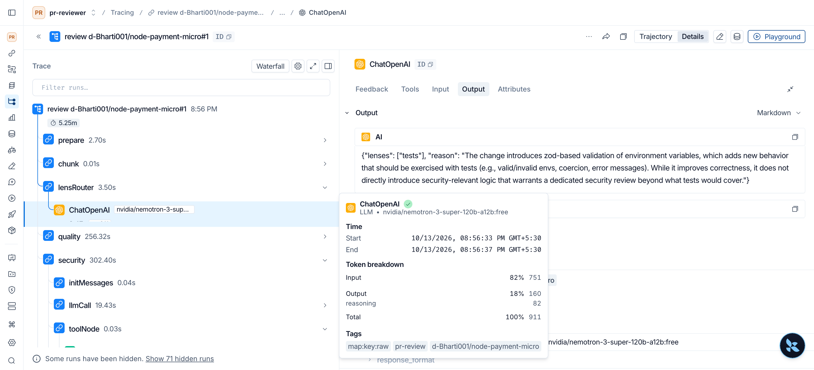
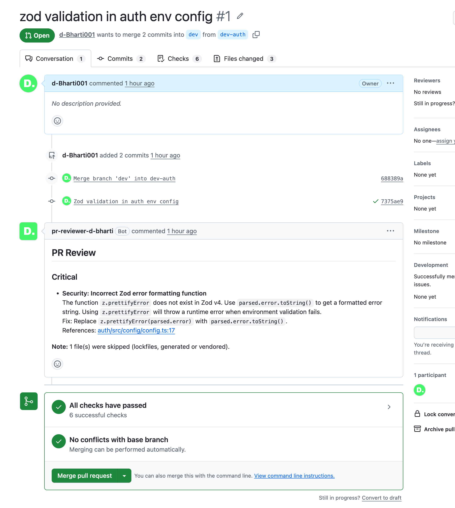
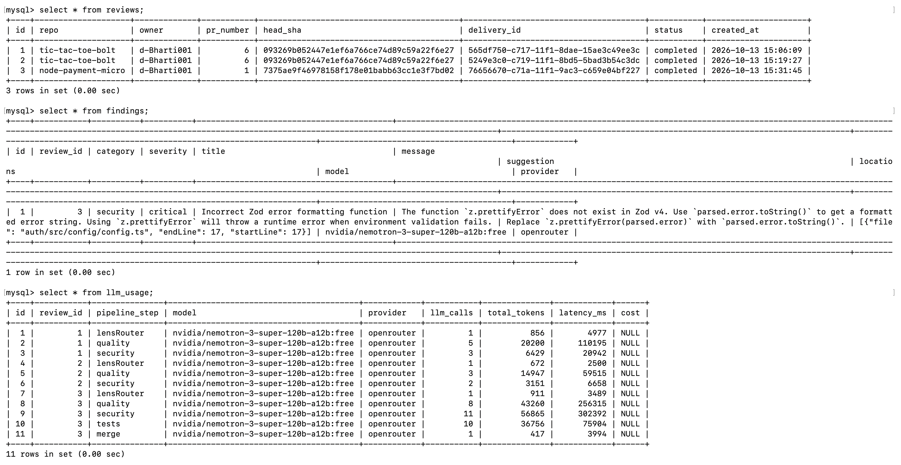
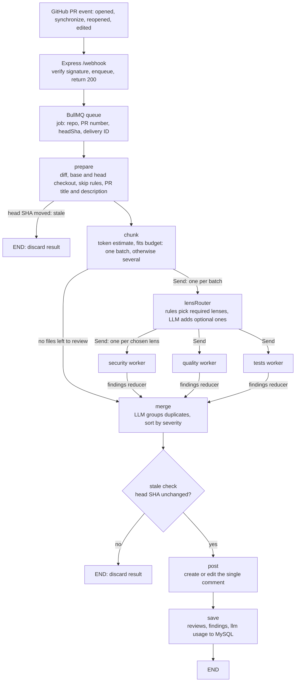
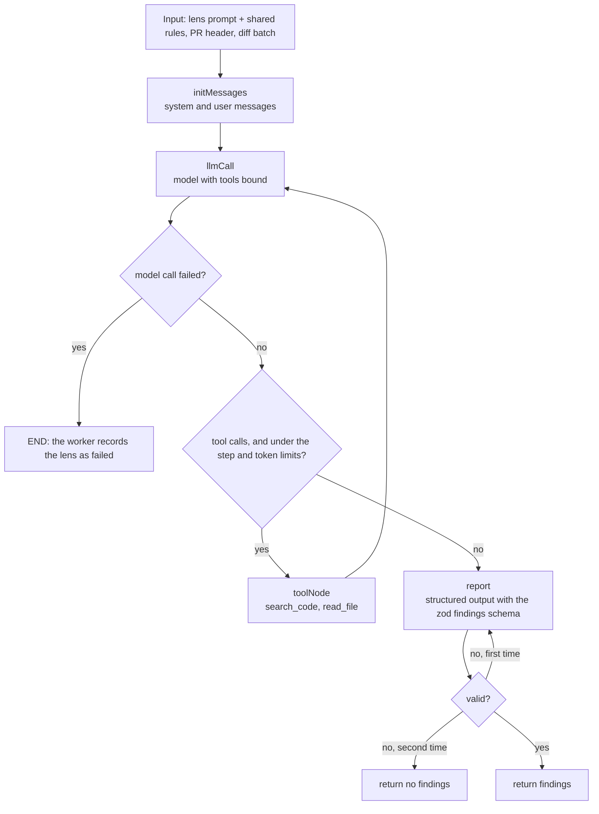

# PR Review Agent

[](https://github.com/d-Bharti001/pr-review-agent/actions/workflows/ci.yml)

A GitHub App that reviews pull requests with LLM agents. It reads the relevant parts of the codebase as needed, and posts **one comment per PR**, edited in place on every update, with findings grouped by severity and permalinks to the exact lines.

**Stack:** TypeScript, Node.js, Express, BullMQ, Redis, MySQL, db-migrate, LangGraph.js, LangChain.js, LangSmith, Octokit, zod, Docker Compose.

### Example run

Model used: `nvidia/nemotron-3-super-120b-a12b:free`
Provider: `openrouter`

**Each review is traced end to end in LangSmith:**

<figure style="text-align: center;">
  
  <figcaption style="font-size: 0.85em;">LangSmith trace of a review</figcaption>
</figure>

**Comment on a GitHub PR:**

<figure style="text-align: center;">
  
  <figcaption style="font-size: 0.85em;">A review comment on a pull request</figcaption>
</figure>

**Every review, finding and model call is saved in the database:**

<figure style="text-align: center;">
  
  <figcaption style="font-size: 0.85em;">The <code>reviews</code>, <code>findings</code> and <code>llm_usage</code> tables</figcaption>
</figure>

## How it works

```
GitHub --webhook--> server --> Redis (BullMQ) --> worker --> review graph --> PR comment
                                                                 |
                                                                 +--> MySQL (reviews, findings, llm_usage)
```

The webhook server verifies the signature and enqueues a job, so GitHub always gets a fast `200`. The worker runs the review as a LangGraph workflow:

- **Lens selection.** Rules pick the required lenses (quality always, security for source or config files). The LLM can only add optional ones, so a diff cannot switch off a review.
- **Lens agents.** Each lens is a small agent with a tool loop (`read_file`, `search_code`) that checks the diff against the real codebase, with limits on calls and tokens.
- **Merge, then post.** Findings are deduplicated and sorted by severity, then the single PR comment is created or edited.



Each lens run is its own small graph:



## Design highlights

- **Reliable webhooks.** The job ID is the GitHub delivery ID, so redeliveries are ignored, and `save` replaces earlier results of the same delivery. A crashed worker's job is picked up again.
- **Stale runs are dropped.** The PR head is checked at the start and again before posting, because a newer push has its own review.
- **Graceful degradation.** A failing lens is reported in the comment instead of failing the review. If the router fails, all optional lenses run.
- **Large diffs** are split into batches under a token budget, and findings are merged afterwards.
- **Any LLM provider** (Anthropic, Gemini, OpenAI, OpenRouter, Ollama) through one `ChatModel` class. Every call is recorded in `llm_usage`, and findings store the model that produced them.

## Documentation

- [Architecture](docs/architecture.md): pipeline, lenses, agent loop, findings, state and failure handling.
- [Setup](docs/setup.md): GitHub App, configuration, Docker Compose, a server with systemd, and the CI/CD pipeline.
- [Tests](docs/tests.md): what each test checks.

## Quick start

```bash
cp .env.example .env     # fill in the GitHub App and LLM values
docker compose up --build
```

The model must support tool calling and structured output; small local models may fail on this. Free-tier API quotas can be too low for a full review, and failed lenses are reported in the GitHub comment.
