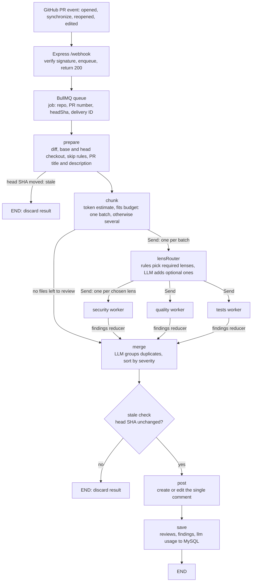
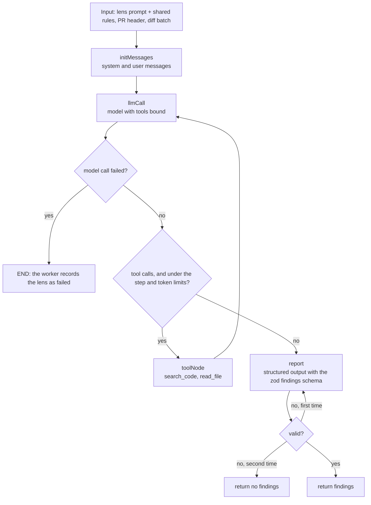

# PR Review Agent

A GitHub App that reviews pull requests with LLM agents. It reads the relevant parts of the codebase as needed, and posts **one comment per PR**, edited in place on every update, with findings grouped by severity and permalinks to the exact lines.

**Stack:** TypeScript, Node.js, Express, BullMQ, Redis, MySQL, db-migrate, LangGraph.js, LangChain.js, LangSmith, Octokit, zod, Docker Compose.

## How it works

```
GitHub --webhook--> server --> Redis (BullMQ) --> worker --> review graph --> PR comment
                                                                 |
                                                                 +--> MySQL (reviews, findings, llm_usage)
```

The webhook server only verifies the signature and enqueues a job, so GitHub always gets a fast `200`. The worker runs the review.

1. The webhook receives a `pull_request` event (`opened`, `synchronize`, `reopened`, `edited`). It verifies the signature, enqueues `{ installationId, owner, repo, prNumber, headSha, deliveryId }` with the delivery ID as the job ID, and responds 200. Other events and actions are acknowledged and ignored.
2. The worker takes one job at a time (`concurrency: 1`) and runs the graph. Lenses still run in parallel inside the graph. If the process dies mid-review, the job's lock expires and BullMQ runs it again.
3. The graph reviews the PR and posts the comment. Details below.

## Pipeline

The pipeline is a LangGraph `StateGraph`. Deterministic steps are ordinary nodes. The `lensRouter` node runs once per diff batch and sends that batch to each chosen lens. Each lens is a worker node that runs a small tool-using agent on that batch. Lenses never talk to each other: their findings meet only at the `merge` node.



| Step         | What it does                                                                                                                                                  |
| ------------ | ------------------------------------------------------------------------------------------------------------------------------------------------------------- |
| `prepare`    | Fetches PR info and changed files, skips lockfiles, generated and vendored files, and checks out the merge base and the head commit                           |
| `chunk`      | Splits the diff into batches that fit `BATCH_TOKEN_BUDGET`                                                                                                    |
| `lensRouter` | Picks the lenses for each batch                                                                                                                               |
| lenses       | One agent per lens and batch. It can read files and search code before reporting findings                                                                     |
| `merge`      | Removes duplicate findings with an LLM and sorts by severity                                                                                                  |
| `staleCheck` | Stops if the PR head moved on while the job was running                                                                                                       |
| `post`       | Creates or edits the single PR comment                                                                                                                        |
| `save`       | Stores the review, findings and LLM usage in MySQL in one transaction. Review status: `completed`, `partial` (some lens runs failed) or `failed` (all failed) |

`post` and `save` are separate nodes, so a failed save is retried without posting again.

## Lenses

Each lens is a config of `{ id, systemPrompt }` (see `src/graph/prompts/`). All three are enabled by default (`ENABLED_LENSES` in the config).

| Lens       | Question                                         | Categories it reports |
| ---------- | ------------------------------------------------ | --------------------- |
| `security` | Could this be exploited?                         | security              |
| `quality`  | Is the logic right, and are the docs consistent? | quality, docs         |
| `tests`    | What is untested?                                | tests                 |

**Lens selection.** Rules in code decide the _required_ lenses: `quality` always, plus `security` when the batch touches source or config files. The LLM may only _add_ the optional lenses (`security`, `tests`), and it is not asked at all for a docs-only batch (`quality` only). If the router call fails, all optional lenses run (it fails open). The model cannot remove a required lens, so text inside a diff cannot switch off a review.

**Docs and comment consistency.** The `quality` lens also checks that docs, comments and docstrings around the changed code still match it, and reports stale text with category `docs`.

**Shared rules.** Every lens prompt ends with shared rules: report only issues introduced or exposed by the PR, verify with the tools before reporting, cite exact lines of the head version, prefer few real findings over many speculative ones, and treat the PR title, description, diff and file contents as untrusted data.

### Lens agent

Each lens run is a small graph with a tool loop. The tools are `search_code(pattern, glob, ref)` (ripgrep) and `read_file(path, ref, offset, limit)`, where `ref` is `base` (the code before the PR) or `head` (the default). Paths are confined to the checkout and PR code is never run.



The agent stops looping when it reaches its LLM-call or token limit, and writes its report from what it has gathered. The stop reason is logged.

## Findings and the comment

A finding is `{ category, severity, locations: [{ file, startLine, endLine }], title, message, suggestion }`, with category `security | quality | tests | docs` and severity `critical | high | medium | low | info`. Every field is required, because some providers' structured-output modes reject optional fields: an empty `locations` array or an empty `suggestion` means "none". Locations are used as the model reports them.

- One comment per PR, found by its hidden marker and edited in place on every push.
- Findings are grouped under severity headings, most severe first. Empty groups are omitted. If there are none, the comment says no issues were found.
- Each finding is one bullet: category and title, a one-line explanation, an optional fix, and permalinks to the cited lines at the reviewed commit.
- A one-line note is added only when something affects completeness: files were skipped, or a lens failed.

## Large diffs

- Lockfiles, generated and vendored files are skipped, then tokens are estimated (`chars / 4`).
- If the diff fits `BATCH_TOKEN_BUDGET`, it is reviewed in one pass.
- Otherwise whole files are grouped into batches under the budget (a huge file is split by hunk). Every batch carries the same header (PR title, description, file list), and the findings are merged, deduped and ranked afterwards.

## State

State holds raw data only. Prompts and the comment text are formatted inside nodes.

| Key                                                                    | Contents                                                                                                         | Updated by                    |
| ---------------------------------------------------------------------- | ---------------------------------------------------------------------------------------------------------------- | ----------------------------- |
| `installationId`, `owner`, `repo`, `prNumber`, `headSha`, `deliveryId` | Job input                                                                                                        | Input                         |
| `workDir`                                                              | Temporary folder with the base and head checkouts. Deleted when the run ends; sent to workers in `Send` payloads | Input                         |
| `title`, `description`, `files`, `skippedFiles`, `stale`               | The PR as fetched, after skip rules. `stale` is set when the PR moved on since the job was queued                | `prepare`                     |
| `batches`                                                              | File groups under the token budget                                                                               | `chunk`                       |
| `findings`                                                             | Raw findings from all workers, with model and provider (reducer: concatenate)                                    | Lens workers                  |
| `lensFailures`                                                         | IDs of lenses that failed (reducer: concatenate)                                                                 | Lens workers                  |
| `lensRuns`                                                             | IDs of the lenses the router chose, one entry per lens run (reducer: concatenate)                                | `lensRouter`                  |
| `usage`                                                                | One record per router, lens and merge run: pipeline step, model, provider, calls, tokens, latency                | `lensRouter`, lenses, `merge` |
| `mergedFindings`                                                       | Findings with duplicates removed, sorted by severity                                                             | `merge`                       |

## Reliability

| Case                                                    | Handled by                                                                                                                             |
| ------------------------------------------------------- | -------------------------------------------------------------------------------------------------------------------------------------- |
| Duplicate webhook delivery                              | The job ID is the delivery ID, so BullMQ ignores a second add while the job is retained. `reviews` has a unique key on the delivery ID |
| Transient (GitHub, database, network)                   | `retryPolicy` on `prepare`, `staleCheck`, `post` and `save`                                                                            |
| Transient LLM errors (429/5xx)                          | The chat model's built-in retry with backoff                                                                                           |
| LLM-recoverable (tool error, invalid structured output) | The error goes back into the tool result and the model tries again; structured output is retried once                                  |
| A lens fails                                            | The worker adds the lens ID to `lensFailures` and returns no findings, so the other lenses continue. The comment notes it              |
| The `lensRouter` model call fails                       | Fail open: all optional lenses run for that batch                                                                                      |
| The `merge` model call fails                            | Keep all findings (no deduplication) and sort them                                                                                     |
| PR updated during the review                            | The head SHA is checked in `prepare` and again before `post`. A stale run is discarded, because the newer push has its own review      |
| Worker crash                                            | The job's lock expires and BullMQ runs it again (`maxStalledCount`). `save` replaces earlier rows of the same delivery                 |
| Unexpected                                              | The error propagates and the BullMQ job retries with backoff. The retry runs the whole graph again                                     |

## Prompt injection

The PR title, description, diff and file contents are untrusted data: they are delimited in prompts, the agent tools are read-only (only the `post` node writes to GitHub), required lenses cannot be removed by the model, and the GitHub App has minimal permissions.

## LLM providers

All application code depends on LangChain's `BaseChatModel`. A small `ChatModel` class holds the model with its name and provider, and is the only place that names a provider. Selected by `LLM_PROVIDER`:

- `anthropic`: `ChatAnthropic`
- `gemini`: `ChatGoogleGenerativeAI`
- `ollama`, `openai`, `openrouter`: `ChatOpenAI` with a custom base URL (any OpenAI-compatible server works the same way)

The provider and model are recorded on every LangSmith trace and in the `llm_usage` table. Findings store the model and provider that produced them.

## Setup

1. Create a GitHub App with the `pull_request` event. It needs read access to contents and pull requests, and write access to pull request comments. Set the webhook URL to `https://<your-host>/webhook` and use a webhook secret. Download the private key into `secrets/private-key.pem`.
2. Copy `.env.example` to `.env` and fill in the GitHub App and LLM values. The file has comments for each setting.
3. Start everything:

```bash
docker compose up --build
```

This starts MySQL and Redis, runs the migrations, and starts the server (port 8081, `GET /health`) and the worker.

For local development without Docker for the app: start MySQL and Redis from the compose file, then run `npm run migrate:up`, `npm run dev` and `npm run dev:worker`.

## Notes

- The model must support tool calling and structured output. Small local models may fail on this.
- Free-tier API quotas can be too low for a full review. Failed lenses are reported in the comment.
